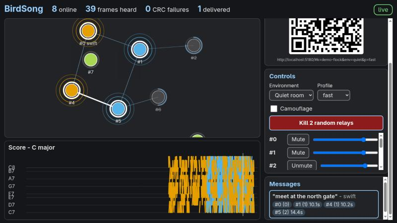

# BirdSong

BirdSong is an acoustic mesh network for people under internet shutdowns. It hides encrypted text messages (up to 140 characters) inside synthetic birdsong. Laptops and phones that hear a message decode it and sing it on, so it hops across a room with no internet, router or server. Messages are encrypted with a shared passphrase, error-corrected with Reed-Solomon and a fountain code, and sound like a jungle, a coast or a city dawn.



The screenshot was taken against the dashboard's mock flock.

## Quick start

Requires Node 24 and, for the mesh, Docker.

**Simulated 8-node mesh in Docker (no audio hardware):**

```
npm install
docker build -f docker/Dockerfile.node -t birdsong-node .
bash scripts/sim-up.sh
```

Open `http://localhost:7070` for the dashboard and `http://localhost:8080/?runtime=remote` (up to 8087) for a node. Stop with `docker compose -f docker/compose.sim.yml down`.

**A real node on a Linux laptop (real speaker and microphone via PipeWire/PulseAudio):**

```
BIRDSONG_ID=1 bash scripts/run-node.sh --key <passphrase> --env jungle
```

Add `--observatory ws://<HUB_IP>:7070` to show it on the dashboard. Start the dashboard with `npm run build -w @birdsong/dashboard` and `CHANNEL_PASSPHRASE=<passphrase> PWA_URL=<pages-url> npm start -w @birdsong/dashboard`.

**A phone:** open the app from the dashboard's "Join the flock" QR code (the static web app in `packages/web`, deployed to GitHub Pages by `.github/workflows/pages.yml`).

## Documentation

- [docs/PROTOCOL.md](docs/PROTOCOL.md): the physical language: envelope, fountain code, frames, chirps, gossip rules, limitations
- [docs/ARCHITECTURE.md](docs/ARCHITECTURE.md): packages, seams, test pyramid
- [docs/RUNBOOK.md](docs/RUNBOOK.md): demo-day checklists and the 3-minute script
- [docs/DEVPOST.md](docs/DEVPOST.md): submission text and sponsor-track mapping
- [docs/PITCH.md](docs/PITCH.md): slide outline

Implementation plans are in `plans/` (status and measured numbers in `plans/README.md`).

## Development commands

| Purpose | Command | Expected on success |
|---|---|---|
| Install | `npm install` | exit 0 |
| Typecheck | `npm run typecheck` | exit 0, no errors |
| Tests | `npm test` | all pass |
| Mesh end-to-end tests | `npm run test:e2e` | all pass |
| One file | `npx vitest run <path>` | all pass |
| Build phone app | `npm run build -w @birdsong/web` | `packages/web/dist` |
| Build dashboard | `npm run build -w @birdsong/dashboard` | `packages/dashboard/dist` |
| Sim smoke test (no Docker) | `bash scripts/smoke-ether.sh` | message arrives |

## Source-code rules

TypeScript runs without a build step (Node strips types natively; Vite and Vitest transpile it themselves), so:

1. Relative imports include the `.ts` extension: `import { x } from './foo.ts'`.
2. Type-only imports use `import type { ... }`.
3. No `enum`, no `namespace`, no constructor parameter properties (`constructor(private x: number)`), because Node cannot strip them.

When passing a typed array to WebCrypto or Web Audio and the compiler complains about `ArrayBufferLike`, pass `x.slice()` (a fresh copy); never change a shared signature to work around it. Protocol constants live in `packages/core/src/constants.ts`.

## Status and limits

The project has no AI/LLM component. Real-room acoustic tests, phone tests and the arm64 image build have not been run by the automated checks; see `docs/PROTOCOL.md` section 9 for the protocol's known limitations.
