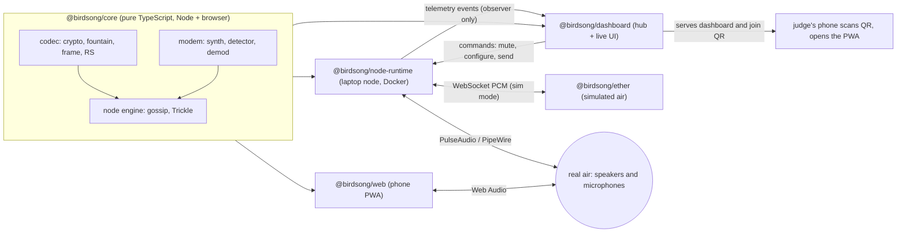

# BirdSong architecture

## Packages and connections

Message data travels only as sound (real air, or the ether in simulation). The hub link carries events for the dashboard and a few commands (mute, change environment, send). Phones send no telemetry: the hub infers a "phone" node when a laptop hears a frame from a sender id it does not know.

| Package | One line |
|---|---|
| `packages/core` | Pure, dependency-light library: constants, codec, modem, node engine, ambient beds, message songs, simulated-air mixer and fake modem. Runs in Node and the browser. |
| `packages/node-runtime` | The laptop node: CLI flags, PulseAudio audio port, ambient player, local HTTP API and UI on port 8080, telemetry client. Runs in Docker. |
| `packages/web` | Phone and browser PWA (Preact + Vite): a full node in the browser, plus the remote UI for container nodes (`?runtime=remote`). Deployed to GitHub Pages. |
| `packages/dashboard` | Hub server (WebSocket relay of events and commands, port 7070) and the projector UI: flock graph, feed, controls, score, join QR. |
| `packages/ether` | The simulated air: a WebSocket service that mixes node audio by distance, used by `scripts/sim-up.sh`, CI and the fallback demo. |

## Seams

`packages/core/src/types.ts` defines three small interfaces that the engine depends on, and nothing else:

- `AudioPort` (speaker and microphone: `start`, `stop`, `onInput`, `play`, `setVolume`)
- `Modem` (`encode`, `push`, `onFrame`, `busy`, `reset`)
- `Clock` (`now`, `setTimeout`, `clearTimeout`)

Why: there is one engine and three audio worlds. A laptop plugs in a PulseAudio port, a phone plugs in a Web Audio port, and simulation plugs in the ether port or an in-process mixer. Tests plug in a fake modem and a virtual clock, so a whole mesh runs in about half a second and gives identical results on every run (a real-modem test is also included, and its timing varies by one listen slot because the random nonce changes the audio). The same code that sings in a room is the code that is tested.

## Test pyramid

Counts from the last run on this branch:

| Level | Command | Result |
|---|---|---|
| Unit and component tests | `npm test` | 44 files, 242 passed, 1 skipped (the skip is the live PulseAudio test, enabled with `BIRDSONG_PULSE_TEST=1`) |
| of which per package | | core 208, dashboard 12, node-runtime 15 (+1 skipped), web 6, ether 1 |
| Mesh end-to-end | `npm run test:e2e` | 2 files, 6 passed: 5 fake-modem mesh cases (multi-hop line, two relays killed, originator dies after its burst, two writers, late joiner) and 1 real-modem three-node case |
| Typecheck | `npm run typecheck` | all workspaces |
| Smoke test of the sim stack | `bash scripts/smoke-ether.sh` | ether + two nodes, sends a message and waits for it, about 8 s (needs no Docker) |

Not covered by automated tests: real speakers and microphones, the two-tab acoustic browser test, phones, and the arm64 image build. These are human checks (see `docs/RUNBOOK.md`).
