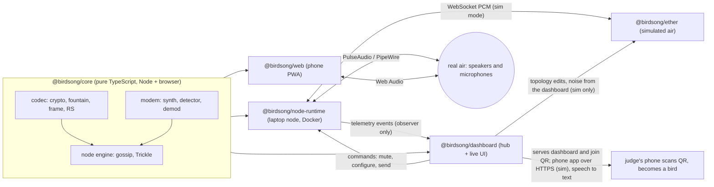

# BirdSong architecture

## Packages and connections

Message data travels only as sound (real air, or the ether in simulation). The hub link carries events for the dashboard and a few commands (mute, change environment, send). In simulation the ether owns the topology (who hears whom). It starts from `docker/topology.txt` and keeps working without the hub. The hub is the only client that can change the topology while the mesh runs. Phones send no telemetry: the hub infers a "phone" node when a laptop hears a frame from a sender id it does not know.

| Package | One line |
|---|---|
| `packages/core` | Pure, dependency-light library: constants, codec, modem, node engine, ambient beds, message songs, simulated-air mixer and fake modem. Runs in Node and the browser. |
| `packages/node-runtime` | The laptop node: CLI flags, PulseAudio audio port, ambient player, local HTTP API and UI on port 8080, telemetry client. Runs in Docker. Also the nursery (`src/nursery.ts`), which starts and stops bird containers for the simulated mesh through the Docker socket. |
| `packages/web` | Phone and browser PWA (Preact + Vite): a full node in the browser, plus the remote UI for container nodes (`?runtime=remote`). Deployed to GitHub Pages. |
| `packages/dashboard` | Hub server (WebSocket relay of events and commands, port 3200; also serves the node app at `/app/` and the interaction log) and the projector UI: flock graph, feed, controls, score, join QR. |
| `packages/ether` | The simulated air: a WebSocket service that mixes node audio by distance or along a manual topology (`ETHER_TOPOLOGY` / `ETHER_TOPOLOGY_FILE`; `GET`/`PUT /topology`, and PUT needs `ETHER_CONTROL_TOKEN`). Noise sources (`/noise` WebSocket, same token; `GET /noise` counts them) are added to what every node hears and to listeners unless `?noise=0`. Used by `scripts/sim-up.sh`, CI and the fallback demo. The parser is `packages/core/src/sim/topology.ts`. |

### Ports (simulated mesh)

| Port | Process | Serves |
|---|---|---|
| 3100 | proxy (Caddy) | `/nodes/<id>/` to the container reachable as `bird<id>` (any id, so added birds work too), `/ether/listen` to the simulated air (only that path) |
| 3200 | hub | dashboard, node app `/app/`, WebSockets `/node`, `/ui` and `/noise` (dashboard noise, relayed to the ether), `/config.json`, `/api/log`, `/api/topology` (relayed to the ether), `/api/birds` (add/remove, relayed to the nursery), `/api/disabled`, `/api/stopped` (mute or unmute every bird), `/api/transcribe` (speech to text through ElevenLabs, when the hub has a key) |
| 3443 | proxy (Caddy) | the hub over HTTPS (`tls internal`, a certificate for `PHONE_HOST`), so phones on the LAN can open `/app/` with the microphone; the dashboard's QR code points here |
| internal | ether 7080, nursery 7090, nodes 8080 | reached by service name on the compose network, not published; the hub uses `http://ether:7080/topology`, `ws://ether:7080/noise` and `http://nursery:7090/birds` (each with a bearer token) |

## Seams

`packages/core/src/types.ts` defines three small interfaces that the engine depends on, and nothing else:

- `AudioPort` (speaker and microphone: `start`, `stop`, `onInput`, `play`, `setVolume`)
- `Modem` (`encode`, `push`, `onFrame`, `busy`, `reset`)
- `Clock` (`now`, `setTimeout`, `clearTimeout`)

Why: there is one engine and three audio worlds. A laptop plugs in a PulseAudio port, a phone plugs in a Web Audio port, and simulation plugs in the ether port or an in-process mixer. Tests plug in a fake modem and a virtual clock, so a whole mesh runs in about half a second and gives identical results on every run (a real-modem test is also included, and its timing varies by one listen slot because the random nonce changes the audio). The same code that sings in a room is the code that is tested.

## Test pyramid

Counts from the last run on this branch:

| Level | Command | Result |
|---|---|---|
| Unit and component tests | `npm test` | 46 files, 270 passed, 1 skipped (the skip is the live PulseAudio test, enabled with `BIRDSONG_PULSE_TEST=1`) |
| of which per package | | core 213, dashboard 23, node-runtime 15 (+1 skipped), web 15, ether 4 |
| Mesh end-to-end | `npm run test:e2e` | 2 files, 7 passed: 6 fake-modem mesh cases (multi-hop line, two relays killed, originator dies after its burst, two writers, late joiner, manual topology) and 1 real-modem three-node case |
| Typecheck | `npm run typecheck` | all workspaces |
| Smoke test of the sim stack | `bash scripts/smoke-ether.sh` | ether + two nodes, sends a message and waits for it, about 8 s (needs no Docker) |

Not covered by automated tests: real speakers and microphones, the two-tab acoustic browser test, phones, and the arm64 image build. These are human checks (see `docs/RUNBOOK.md`).

## Source-code rules

TypeScript runs without a build step (Node strips types natively; Vite and Vitest transpile it themselves), so:

1. Relative imports include the `.ts` extension: `import { x } from './foo.ts'`.
2. Type-only imports use `import type { ... }`.
3. No `enum`, no `namespace`, no constructor parameter properties (`constructor(private x: number)`), because Node cannot strip them.
4. When passing a typed array to WebCrypto or Web Audio and the compiler complains about `ArrayBufferLike`, pass `x.slice()` (a fresh copy); never change a shared signature to work around it.

Protocol constants live in `packages/core/src/constants.ts`. TypeScript is pinned to 5.8 (5.9+ changes the DOM `BufferSource` typings and breaks WebCrypto calls with plain `Uint8Array`).

## Development commands

| Purpose | Command | Expected on success |
|---|---|---|
| Install | `npm install` | exit 0 |
| Typecheck | `npm run typecheck` | exit 0, no errors |
| Tests | `npm test` | all pass |
| Mesh end-to-end tests | `npm run test:e2e` | all pass |
| One file | `npx vitest run <path>` | all pass |
| Build phone app | `npm run build -w @birdsong/web` | `packages/web/dist` |
| Build dashboard | `npm run build -w @birdsong/dashboard` | `packages/dashboard/dist` |
| Sim smoke test (no Docker) | `bash scripts/smoke-ether.sh` | message arrives |

## Where things are

- `plans/`: the implementation plans, with status and measured numbers in `plans/README.md` ("Notes from executors").
- `docs/PROTOCOL.md`: the on-air format and its known limitations. `docs/RUNBOOK.md`: demo day. `docs/DEVPOST.md` and `docs/PITCH.md`: submission text and slide outline.
- `samples/`: example WAVs (message songs, ambient beds), regenerated by `node scripts/render-samples.ts`.
- The project has no AI/LLM component: compression is the static Unishox2 dictionary.
